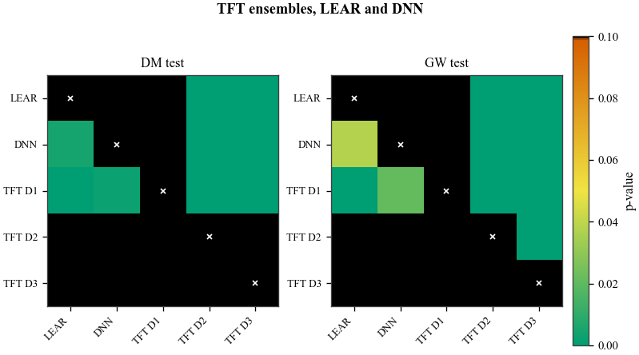
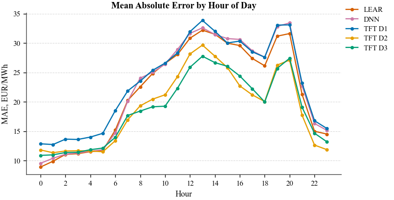
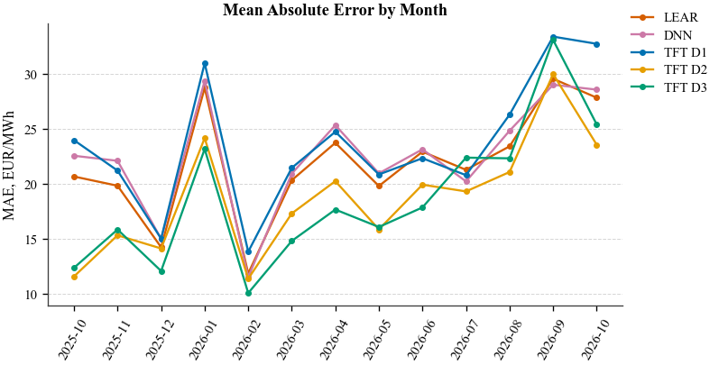

# Day-Ahead Electricity Price Forecasting in Poland

This project forecasts the 24 hourly electricity prices for the next delivery day in Poland. It compares a Temporal Fusion Transformer (TFT) with two forecasting benchmarks, LEAR and a deep neural network (DNN), and asks how forecast accuracy changes when cross-border data are added.

> The best TFT ensemble reached **18.855 EUR/MWh MAE**, **13.4% lower than LEAR** over 364 held-out days.

[Test results](#test-results) · [Data and modelling](#data-and-modelling) · [Explore the notebooks](#explore-the-notebooks)

## Test results

All models were scored on the same 8,736 hourly prices from **20 October 2025 to 18 October 2026**. MAE and RMSE are in EUR/MWh. An rMAE below 1 means the model beats a forecast that repeats the price from the same hour one week earlier.

| Forecast | MAE ↓ | RMSE ↓ | rMAE ↓ |
| --- | ---: | ---: | ---: |
| **TFT D3 ensemble** | **18.855** | **31.417** | **0.508** |
| TFT D2 ensemble | 19.008 | 31.813 | 0.513 |
| LEAR | 21.783 | 34.823 | 0.587 |
| DNN | 22.447 | 36.404 | 0.605 |
| TFT D1 ensemble | 23.394 | 36.917 | 0.631 |

**D2 made the largest gain among the TFT configurations.** D1 trailed both benchmarks. D2, which adds market coupling data, reduced MAE by 18.7% relative to D1. D3 had the lowest overall error and was only 0.153 EUR/MWh ahead of D2. The Diebold-Mariano and Giacomini-White tests both favour D2 and D3 over LEAR and DNN. Only Giacomini-White favours D3 over D2.

### Forecast accuracy tests (DM & GW)

Each cell shows the one-sided *p*-value for the column forecast outperforming the row forecast. Values below 0.05 indicate statistical significance.

### Error profiles

**By hour.** LEAR has the lowest error from midnight through 04:00. Both TFT D2 and D3 beat the benchmarks at every hour from 06:00 through 23:00.

**By month.** TFT D2 or D3 has the lowest MAE in 12 of the 13 months shown. DNN leads in September 2026. Both October points cover partial months. The full analysis also shows how the lead of D2 and D3 narrowed in the second half of the test period. [Full test comparison](notebooks/06_comparison/01_test.ipynb)

## Data and modelling

The data pipeline combines electricity prices and power system forecasts from **ENTSO-E**, market coupling data from **JAO**, and commodity prices and exchange rates from **Investing.com**. It audits gaps and duplicates, aligns the sources to a common hourly grid, and handles daylight saving time changes.

TFT uses 72 hours of history and separates historical inputs from variables available for the forecast day. Each feature set keeps the inputs from the previous step.

| TFT feature set | Inputs added at this step |
| --- | --- |
| **D1** | Polish price history, demand and generation forecasts, calendar, fuel and carbon prices, and exchange rates |
| **D2** | Polish market coupling data, including cross-border exchange, net positions and system forecasts |
| **D3** | Neighbouring market data, including load forecasts, price spreads, net positions and flows |

Each feature set has its own Optuna study. The five shortlisted configurations per set were retrained with five random seeds and ranked by mean validation MAE. Each test ensemble averages the five forecasts from its selected configuration. The LEAR and DNN benchmarks use `epftoolbox` and a smaller set of Polish inputs. They are refit daily. TFT weights are fixed throughout the test period.

The interpretation notebooks look at which inputs receive weight and which historical hours receive attention. In D2, market coupling accounts for about 53% of the variable-selection weight on the forecast day.

## Explore the notebooks

| If you want to see… | Start here |
| --- | --- |
| How performance varies by hour, weekday and month, and how the forecasts compare statistically | [Test comparison](notebooks/06_comparison/01_test.ipynb) |
| How repeated training changed the choice of hyperparameters | [TFT model selection](notebooks/03_model_selection/03_TFT.ipynb) |
| Which groups of inputs TFT uses and which hours of history receive more attention | [Variable selection](notebooks/05_tft_explainability/01_feature_importance.ipynb) · [Encoder attention](notebooks/05_tft_explainability/02_attention.ipynb) |
| How the raw data become modelling datasets | [Data quality audit](notebooks/01_per_source/entsoe/03_data_quality_audit.ipynb) · [Dataset construction](notebooks/02_combined/01_merging.ipynb) |

The notebooks include saved tables and figures for browsing on GitHub. Rerunning the pipeline starts with local source data, and fetching data from ENTSO-E and JAO uses API credentials.

[Backtest notebooks](notebooks/04_backtest) · [Python modules](src)
