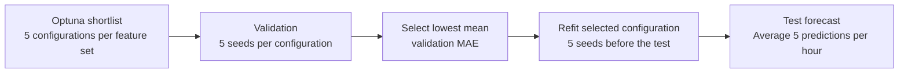

# How the forecasts are backtested

[Project overview](../../README.md) · [TFT tuning guide](../tft-tuning/README.md)

The backtest simulates one forecast per delivery day. Each forecast contains 24 hourly prices. All models are scored against the same 8,736 observed Polish prices over 364 days.

## The three time periods

Dates use the Warsaw delivery calendar and include both endpoints. The split is chronological.

| Split | Dates | Days | Role |
| --- | --- | ---: | --- |
| Training | 20 Jun 2022 to 15 Jun 2025 | 1,092 | Fit TFT during the search and shortlist evaluation. Select DNN settings within this period |
| Validation | 16 Jun 2025 to 19 Oct 2025 | 126 | Score Optuna trials and choose a TFT configuration per feature set |
| Test | 20 Oct 2025 to 18 Oct 2026 | 364 | Evaluate daily forecasts from the chosen procedures |

## How each model produces a test forecast

The backtest advances one delivery day at a time. Prices observed earlier in the test period can become history for later forecasts. What changes between days depends on the model.

- **LEAR.** For each delivery day, re-estimate the regression coefficients using the preceding 1,092 days, then forecast the next 24 hours. The calibration window advances by one day before the next fit.
- **DNN.** Choose the network hyperparameters within the training period. During the test, keep those settings fixed and retrain the network weights each day using a rolling three-year window. The refitted network forecasts the next 24 hours.
- **TFT.** After validation, fit five models per feature set once on the latest 1,092 days ending on 19 Oct 2025. This window includes the validation period. Each test day, feed the updated 72-hour history and inputs known for that day to the same five fitted models. Their weights stay fixed, and their predictions are averaged hour by hour.

LEAR and DNN share the same inputs beyond price history: the Polish load forecast and lagged residual load. TFT uses the inputs in D1, D2 or D3. [Data and feature sets](../data-pipeline/README.md#which-signals-are-visible-to-the-models) · [Baseline implementation](../../src/utils/epf.py) · [TFT test runner](../../src/utils/tft/backtest.py)

## TFT has two separate rounds of training

For each feature set, the five shortlisted configurations are trained with seeds 1 to 5 on the training split. That gives **25 fits per feature set**, each scored on the same validation period. The configuration with the lowest mean MAE across its five runs goes through to the test.

The table compares the first-place configuration from the Optuna search with the final choice. **Both are scored under the same five-seed validation procedure.** Scores are mean ± standard deviation in EUR/MWh. The standard deviation shows how much MAE varies across runs.

| Feature set | Optuna leader after five fits | Selected configuration after five fits | Reduction in mean MAE |
| --- | ---: | ---: | ---: |
| D1 | 19.127 ± 0.367 | **18.988 ± 0.328** | 0.14 |
| D2 | 15.809 ± 0.964 | **15.809 ± 0.964** | 0.00 |
| D3 | 17.078 ± 1.689 | **16.498 ± 0.439** | 0.58 |

The five-seed check changes the choice for D1 and D3. D3 shows the largest gain in mean MAE and a much smaller spread across seeds. D2 keeps the original Optuna leader. [Validation scores and trial details](../../notebooks/03_model_selection/03_TFT.ipynb)

Each selected configuration is then fitted from scratch using the same seed IDs and the newer pretest window. That produces five new models per feature set. To score the test ensemble, first average the five predictions at each timestamp, then calculate MAE. The best individual seed on the test set is identified after scoring and serves as a diagnostic alongside the ensemble. [Five-seed forecast code](../../src/utils/tft/validate.py)

## Reading the test results

MAE averages absolute errors across all test hours. RMSE is more sensitive to large errors. Relative MAE compares the model with a weekly naive forecast that repeats the price from the same hour one week earlier. The Diebold-Mariano and Giacomini-White tests compare daily absolute forecast errors with all 24 hours considered jointly. The error profiles show how the gap between models changes by hour, weekday and month.

The test compares complete forecasting procedures, including their inputs and update schedules. D2 and D3 kept lower MAE than both baselines in the second half of the test, with a smaller lead. Isolating the effect of refit frequency would require comparing the same model and inputs under different refit schedules. [Test comparison](../../notebooks/06_comparison/01_test.ipynb)

[LEAR backtest](../../notebooks/04_backtest/01_LEAR.ipynb) · [DNN backtest](../../notebooks/04_backtest/02_DNN.ipynb) · [TFT backtest](../../notebooks/04_backtest/03_TFT.ipynb)
