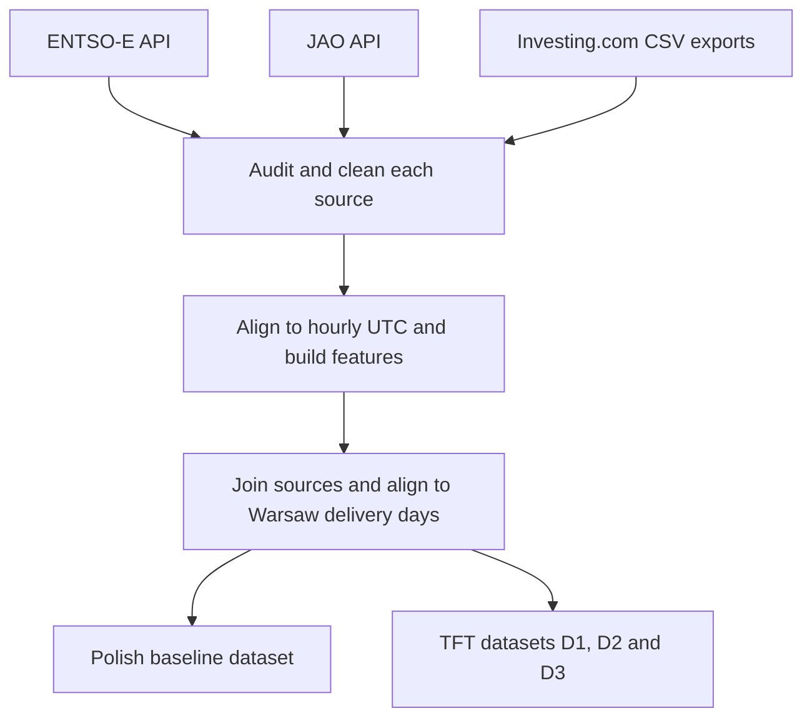

# From raw market data to hourly model inputs

[Project overview](../../README.md) · [Backtesting guide](../backtesting/README.md)

The target is the Polish day-ahead electricity price in EUR/MWh. Three sources describe different parts of the market. The pipeline gives them a common hourly clock and controls which inputs TFT can use for the delivery day.

## What comes from each source

| Source | Raw input | Role in the models |
| --- | --- | --- |
| **ENTSO-E Transparency Platform** | Prices, load and generation series for Poland and selected markets. The API downloads are batched by month and saved as Parquet | Polish prices supply the target and price lags. The Polish load forecast feeds all models. Foreign prices and load forecasts contribute spreads and demand signals to D3 |
| **JAO Publication Tool** | Day-ahead grid forecasts, exchange schedules, allocation constraints and net position limits fetched through the API | D2 adds Polish market coupling signals. D3 adds foreign net positions and flows between neighbouring zones |
| **Investing.com** | Daily CSV prices for Dutch TTF gas, Rotterdam coal, EU emissions allowances and EUR/PLN | D1 adds lagged price levels for fuel, carbon and currency |

The ENTSO-E panel covers Poland, Germany-Luxembourg, Czechia, Slovakia, Lithuania and Sweden SE4. Investing.com exports are read from `data/raw/investing_com/`. [API clients](../../src/api) · [Investing.com source overview](../../notebooks/01_per_source/investing_com/01_data_overview.ipynb)

## How the hourly grid is built

1. **Check the downloaded data.** The ENTSO-E workflow joins overlapping download ranges, checks for disagreements in overlaps and removes duplicate timestamps. The audits check index integrity and missing data. For example, Lithuania's generation forecast is dropped because of extensive gaps. JAO cleaning removes sparsely populated columns before building features.
2. **Align the sources in UTC.** ENTSO-E and JAO are resampled by hourly mean. Bounded gaps of up to three hours can be interpolated. For longer gaps, the pipeline looks back by one day for wind and solar forecasts and one week for other series. Investing.com daily prices are carried forward to the hourly grid, including weekends and trading holidays.
3. **Join and form delivery days.** The target and feature blocks are joined on their shared UTC timestamps. The assembled data are converted to Warsaw clock time. The missing spring 02:00 is interpolated and the repeated autumn 02:00 is averaged, giving the models 24 rows per delivery day.

[Range merging](../../notebooks/01_per_source/entsoe/02b_merging_ranges.ipynb) · [Preprocessing code](../../src/utils/preprocessing.py) · [Dataset construction](../../notebooks/02_combined/01_merging.ipynb)

## Which signals are visible to the models

TFT separates variables available for the next day from historical inputs. The decoder receives calendar values, lagged prices from earlier days, day-ahead load forecasts and JAO schedules. Same-hour price spreads include the Polish price being predicted, so they are historical inputs to the encoder. Polish wind, solar and total generation forecasts are also treated as historical inputs in this experiment. Commodity and currency series are shifted by 24 hours and used as historical inputs.

The LEAR and DNN dataset has the Polish target, the day-ahead load forecast and a 24-hour lag of residual load. Residual load here is the load forecast minus the wind and solar forecasts. TFT D1 combines Polish fundamentals with calendar and macro inputs, D2 adds Polish market coupling, and D3 adds information from neighbouring markets. Each stage retains the earlier inputs.

The final merge reports **37,968 hourly rows per dataset** over the modelling window. Each of the four datasets is saved as `full`, `train`, `val` and `test`. TFT datasets use Parquet and the baseline uses CSV. [Train, validation and test dates](../backtesting/README.md#the-three-time-periods)

## Follow one source through the notebooks

| Source | Start with the raw data | See the inputs used by the models |
| --- | --- | --- |
| ENTSO-E | [Download plan](../../notebooks/01_per_source/entsoe/02_data_fetching.ipynb) · [Quality audit](../../notebooks/01_per_source/entsoe/03_data_quality_audit.ipynb) | [ENTSO-E features](../../notebooks/01_per_source/entsoe/06_feature_engineering.ipynb) |
| JAO | [Download plan](../../notebooks/01_per_source/jao/02_data_fetching.ipynb) · [Quality audit](../../notebooks/01_per_source/jao/03_data_quality_audit.ipynb) | [JAO features](../../notebooks/01_per_source/jao/06_feature_engineering.ipynb) |
| Investing.com | [Raw exports](../../notebooks/01_per_source/investing_com/01_data_overview.ipynb) · [Quality audit](../../notebooks/01_per_source/investing_com/03_data_quality_audit.ipynb) | [Investing.com features](../../notebooks/01_per_source/investing_com/06_feature_engineering.ipynb) |
