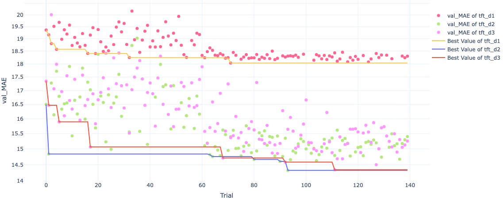

# How TFT hyperparameters are selected

[Project overview](../../README.md) · [Backtesting guide](../backtesting/README.md)

TFT is tuned separately for D1, D2 and D3 because each configuration receives a different set of inputs. Each Optuna study searches on the same chronological validation period. Its job is to produce a shortlist. The final configuration is chosen after retraining that shortlist across five seeds. [Feature sets and data preparation](../data-pipeline/README.md)

## What Optuna searches

All three studies use a 72-hour encoder and a 24-hour forecast horizon. The model learns a point forecast using median quantile loss and AdamW. Model training starts from seed 42 for each search trial so the first pass compares candidate settings under the same seeding scheme.

| Area | Settings explored |
| --- | --- |
| Model capacity | Hidden size of 64, 128 or 256. The number of attention heads and the number of LSTM layers are each chosen from 1, 2 or 4 |
| Regularisation | Dropout from 0.05 to 0.25. Weight decay from `1e-6` to `1e-2` |
| Optimisation | Learning rate from `1e-4` to `5e-3`. Gradient clipping from 0.01 to 1.0 |

Learning rate, weight decay and gradient clipping are sampled on log scales. The first 60 trials are sampled at random. Optuna then uses multivariate TPE to propose combinations based on earlier results.

## How a trial is scored

1. Fit on the training split and forecast the 24 hours of each validation day. Record validation MAE after each epoch.
2. Train for up to 40 epochs. Early stopping ends a run when its validation MAE plateaus. Optuna's median pruner uses the reported three-epoch averages. It has a 10-step warmup and waits for 30 completed trials, with at least five prior scores available for the step it compares.
3. Rank completed trials by the **lowest mean validation MAE across three consecutive epochs**. The middle epoch in that window becomes the training budget for later fits. For example, if epochs 8 to 10 give the best average, later fits run for nine epochs.
4. Save the five best completed trials per feature set, including their parameters and epoch budgets, to `top5.json`.

The saved search curves put D2 and D3 near 14.3 EUR/MWh and D1 near 18.0 EUR/MWh. These are search scores from one training run per trial. For D3, trial 111 led this stage, but trial 112 had the lower mean MAE when retrained across five seeds. [Model selection notebook](../../notebooks/03_model_selection/03_TFT.ipynb)

The figure reflects the recorded experiment, whose notebook lists a search batch size of 128 and early stopping patience of 10 epochs. New runs of the current search script use 256 and 6, respectively. [Tuning code](../../src/utils/tft/tuning.py) · [Shortlist export](../../src/utils/tft/top_trials.py)

[Continue to validation and backtesting](../backtesting/README.md)
